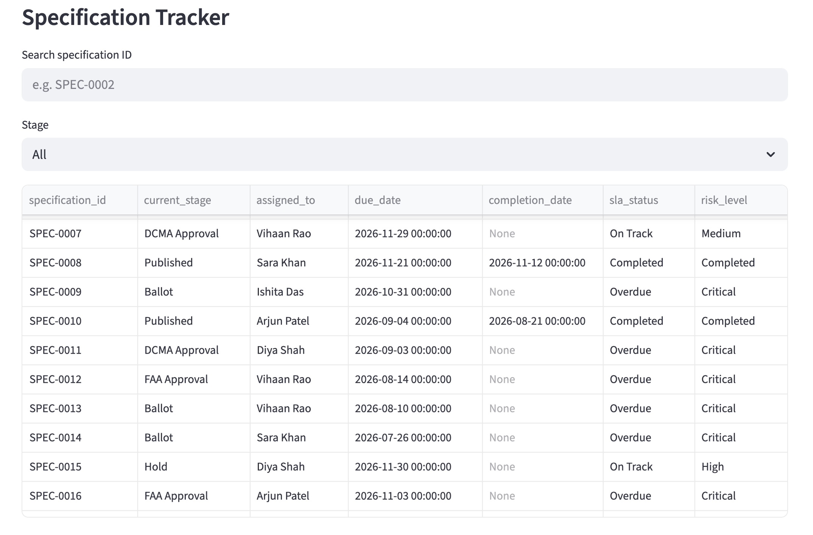

# Specification Lifecycle & SLA Analytics

**Engineering workflow monitoring and decision support | Python · PostgreSQL · Streamlit**

An interactive portfolio application for tracking engineering specifications through approval stages, monitoring service-level agreement (SLA) deadlines, identifying approval backlogs, and prioritizing follow-up actions.

> **Data disclosure:** This is a portfolio simulation using synthetic specification records. It does not contain client, Rolls-Royce, or other proprietary engineering data. Risk scores are transparent business rules, **not** machine-learning predictions or certified engineering assessments.

## Business problem

Engineering specifications can move through multiple review and approval stages. Without a central view, stakeholders may struggle to see which items are overdue, where approvals are accumulating, and which specifications need attention first.

This project answers:
- How many specifications are active, overdue, or completed?
- Which approval stages have the largest overdue backlogs?
- Which active specifications should be prioritized for follow-up?
- Can stage changes be recorded with an audit trail?

## Dashboard

| Tab | Key capabilities |
| --- | --- |
| **Executive Overview** | KPI scorecard, approval backlog vs. overdue chart, risk distribution, top 10 management priorities |
| **Specification Management** | Search/filter records, update approval stages, inspect change history |
| **SLA & Risk Monitoring** | Explainable risk scores, recommended actions, CSV export, SLA alerts and read/unread tracking |

Add screenshots of your tested dashboard to `screenshots/` and uncomment these lines:

<!--  -->
<!--  -->
<!--  -->

## Technology

- **Python / pandas:** data preparation, KPI calculations, risk logic
- **PostgreSQL:** specification, history, and notification persistence
- **SQLAlchemy + psycopg:** database connectivity and transactional updates
- **Streamlit + Plotly:** interactive interface and visualizations

## How it works

```text
PostgreSQL
  ├── specification_tracker ──┐
  ├── stage_history ──────────┼──> Python / pandas analytics ──> Streamlit dashboard
  └── sla_notifications ──────┘                 │
             ▲                                 └──> risk ranking and CSV export
             └──────── stage updates / notification actions ────────────────────
```

**Rule-based risk scoring:** A score from 0 to 100 combines deadline urgency (up to 60 points), known stage age (up to 30), and an on-hold adjustment (10). Scores are grouped into Critical (75+), High (50–74), Medium (25–49), and Low (below 25). Unknown stage age contributes zero points rather than a guessed value.

**Data limitations:** Stage history records dates rather than precise timestamps; multiple same-day transitions cannot be reliably sequenced. Stage age is left unknown when the latest recorded stage cannot be determined unambiguously. This is a descriptive prioritization tool, not a prediction of future approval times.

**Auditability:** Stage updates use a single database transaction to change the specification and insert a history record. Alerts are generated when requested in the UI, not by a background scheduler.

## Local setup

**Prerequisites:** Python 3.10+ and a local PostgreSQL instance with the three required tables (`specification_tracker`, `stage_history`, `sla_notifications`) and compatible columns. The app does **not** create or seed these tables automatically. The source dataset and database initialization scripts are not included in this starter package; see *Reproducibility* below.

```bash
python3 -m venv .venv
source .venv/bin/activate
pip install -r requirements.txt
```

Configure credentials **in your terminal**, not in source code:

```bash
export SPEC_DB_NAME=specification_lifecycle_test
read -s SPEC_DB_PASSWORD
export SPEC_DB_PASSWORD
streamlit run app.py
```

Enter the local PostgreSQL password when prompted by `read -s`. The current application connects to `localhost:5432` as PostgreSQL user `postgres`. Change these settings in `get_engine()` if your environment differs. Do not commit passwords or `.env` files.

## Reproducibility and planned improvements

This repository package contains the dashboard code, dependencies, and documentation. To make the project fully reproducible on a fresh machine, add a **sanitized schema migration** (`schema.sql`) and a **synthetic-only data seed script**. Verify the schema against your existing PostgreSQL database before publishing either. Do not upload a database dump containing private data.

## Testing

The dashboard's five main user flows were manually tested in the local development environment: executive charts, tracker/filtering, stage update with audit history, risk export, and notification actions. Automated tests are not yet included.

## Portfolio scope

This project demonstrates practical SQL/Python analytics, data-backed dashboard design, workflow auditability, and transparent operational prioritization. Figures shown in the dashboard are generated from synthetic records and should not be represented as realized business impact.
