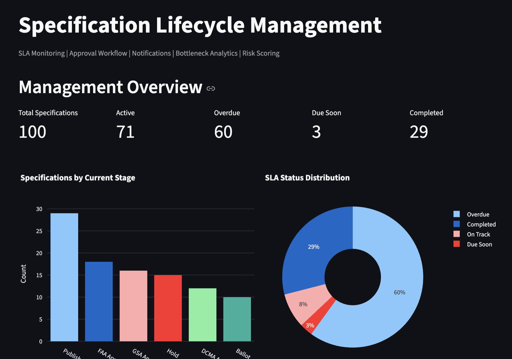
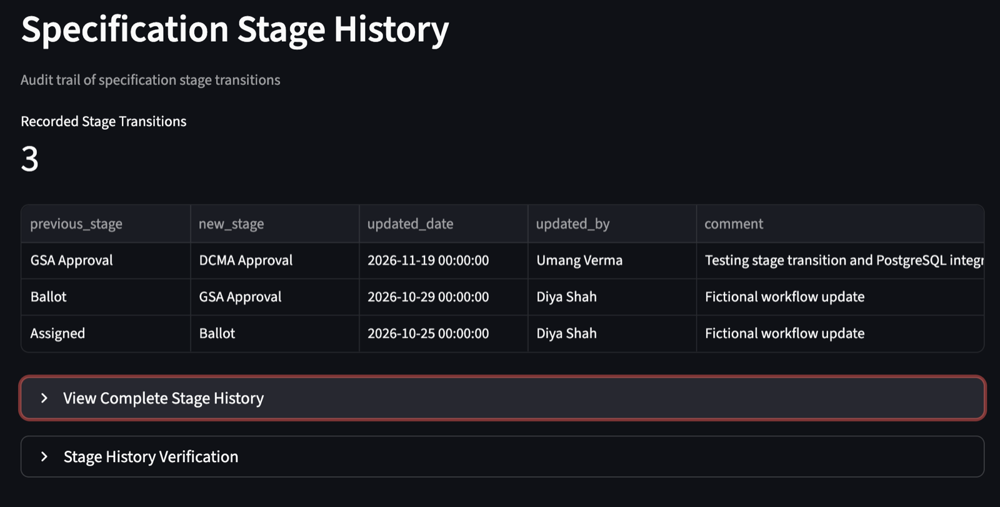
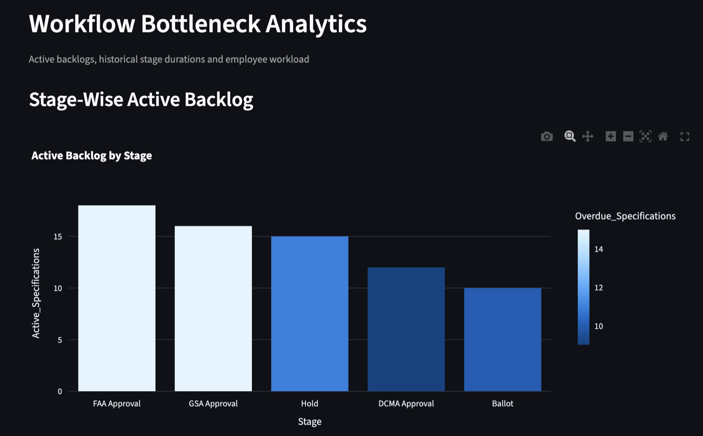
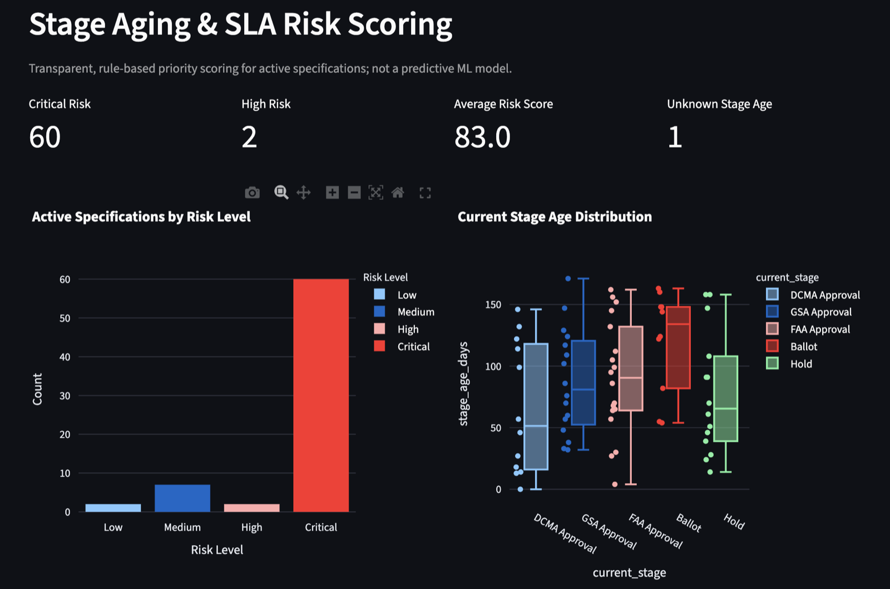
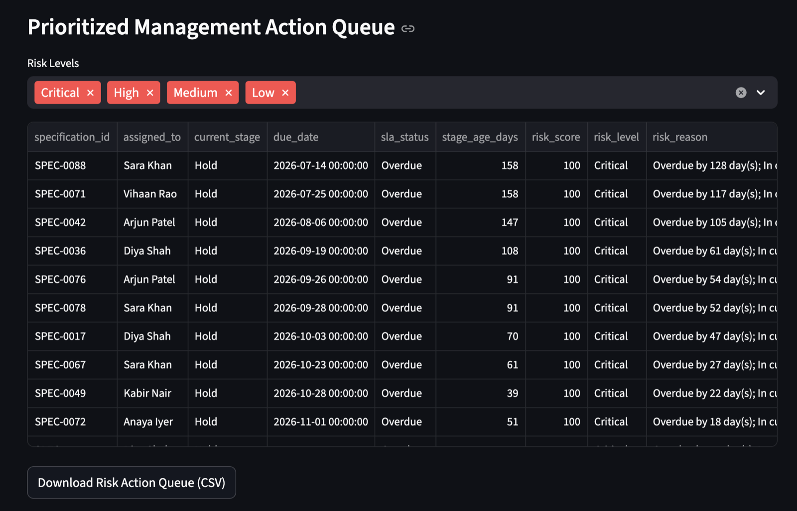

# Specification Lifecycle Management & SLA Analytics

An end-to-end workflow analytics application built using **Python, PostgreSQL, Streamlit, SQLAlchemy, Pandas, and Plotly**.

## Project Overview

This project simulates an engineering specification approval process involving multiple stakeholders, approval stages, and SLA deadlines.

The objective is to improve workflow visibility, monitor SLA compliance, identify approval bottlenecks, and prioritize high-risk specifications.

**All project data is synthetic and intended for portfolio demonstration.**

## Business Problems

- Limited visibility into specification approval progress
- Delayed identification of SLA breaches
- Approval-stage bottlenecks
- Uneven employee workloads
- Difficulty tracking workflow changes
- Lack of systematic risk prioritization

## Technology Stack

| Technology | Purpose |
|---|---|
| Python | Application logic and analytics |
| PostgreSQL | Database management |
| SQLAlchemy | Database connectivity |
| Pandas | Data processing |
| Streamlit | Interactive dashboard |
| Plotly | Data visualization |

## Key Features

### Specification Lifecycle Tracking
Track specifications through Assigned, Ballot, GSA Approval, FAA Approval, DCMA Approval, Hold, and Published stages.

### SLA Monitoring
Monitor active, overdue, due-soon, and completed specifications.

### Workflow Updates and Audit Trail
Update specification stages and maintain historical records of workflow changes.

### SLA Notifications
Generate overdue and due-soon alerts with read/unread tracking and duplicate prevention.

### Workflow Bottleneck Analytics
Analyze stage-level backlogs, approval durations, overdue specifications, and employee workloads.

### Stage Aging and Risk Scoring
Estimate time spent in current stages and prioritize specifications using rule-based SLA risk scores.

### Management Action Queue
Identify specifications requiring immediate operational attention.

## Dashboard Screenshots

### 1. Management Dashboard

### 2. SLA Monitoring

### 3. Workflow Bottleneck Analytics

### 4. Stage Aging and SLA Risk Scoring

### 5. Management Action Queue

## Database Architecture

The PostgreSQL database contains five tables:

- `specification_tracker` — Specification lifecycle records
- `stage_history` — Stage transition audit trail
- `sla_notifications` — SLA alerts and notification status
- `employee_master` — Employee reference information
- `data_dictionary` — Database metadata

Database schema: `sql/schema.sql`

Synthetic sample data: `data/sample_specifications.csv`

The database schema is available in `sql/schema.sql`.
A sample of 20 synthetic specification records is included in
`data/sample_specifications.csv`.

The sample CSV is provided for demonstration and is not a
complete database initialization script.

Database setup scripts will be added separately.

## Limitations

- Stage duration calculations use dates rather than timestamps.
- SLA risk scoring is rule-based, not a machine-learning prediction.
- Notifications require application execution and are not independently scheduled.
- Current database connectivity is configured for local development.

## Future Improvements

- Cloud deployment
- Automated notification scheduling
- Historical SLA trend reporting
- Role-based access control

## Author

GitHub: https://github.com/vumang44-data

**Project Type:** Data Analytics | Workflow Management | SLA Monitoring